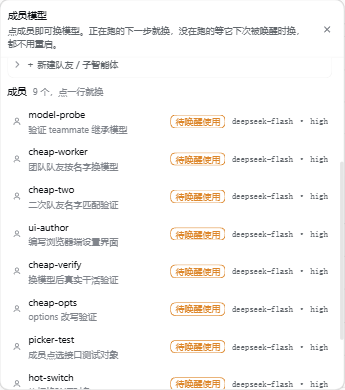
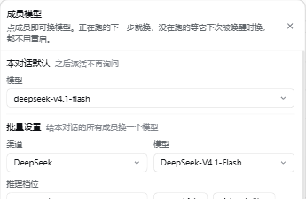
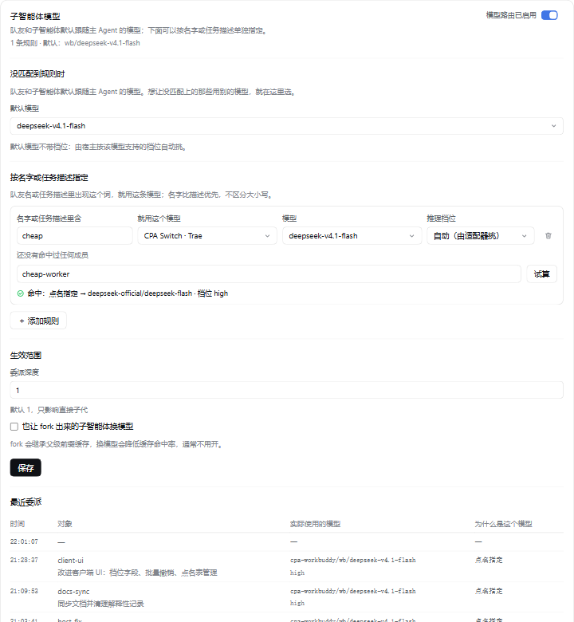
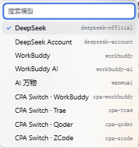
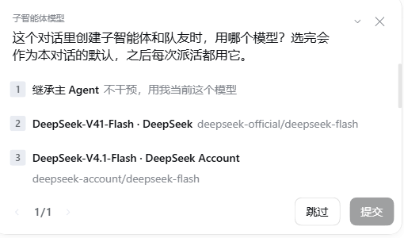

<div align="center">

# dsh-switchboard

**给 DeepSeek Harness 的每个子智能体和队友，接通各自的模型**

主 Agent 用一个模型，派出去的活换一个：贵的活给强模型，琐碎的活给便宜的

[](LICENSE)
[](.node-version)
[](package-lock.json)
[](docs/ARCHITECTURE.md)

[为什么](#为什么需要它) · [怎么工作](#怎么工作) · [能力](#能力) · [安装](#安装) · [界面](#界面) · [生效时机](#生效时机) · [边界](#边界) · [兼容性](#兼容性)

</div>

<div align="center">



<sub>对话头部点「模型」打开的成员面板，每一行标出该成员当前的生效状态与实际模型</sub>

</div>

## 为什么需要它

原生工具做不到这件事：

| 工具 | 模型字段 | 问题 |
|---|---|---|
| `spawn_teammate` | 无 | 队友一律继承主 Agent 的路由 |
| `subagent` | 有 | 每次调用手写参数，且要过白名单 |

这个插件把它变成一块接线板：一个对话里的成员都在板上，每人接一条线路，点一下就换。

## 怎么工作

每个成员实际用哪个模型，按这张表从前往后找，命中即止：

| 顺序 | 来源 | 命中条件 |
|---|---|---|
| 1 | 点名指定 | `members[队友名]`，或 `members['#<子会话 id>']` |
| 2 | 本对话默认 | `sessions[<本对话 id>]` |
| 3 | 规则 | 队友名精确 → 队友名包含 → 委派描述包含 |
| 4 | 全局默认 | `defaultRoute` |
| 5 | 继承 | 主 Agent 当前的路由 |

命中的是哪一层，界面会直接写出来，不用猜。

## 能力

| 能力 | 说明 |
|---|---|
| 点成员换模型 | 头部「模型」入口列出全部队友与子智能体，点一行即换 |
| 按规则批量指定 | 一条规则命中多个成员，匹配名字或任务描述，子串、不区分大小写 |
| 按模型选档位 | 规则和全局默认都能指定推理档位，选项来自模型自己声明的档位；换模型时自动调和，新模型不认的档退回「自动」 |
| 按对话设默认 | 首次派活问一次，之后整个对话沿用，不再打扰 |
| 运行时生效 | 运行中的成员下一步就换，不需要重启 Harness |
| 一键全换 | 本会话所有成员切到同一模型，或一键退回继承；批量操作要二次确认，成功后 5 秒内可撤销 |
| 点名表清理 | 面板底部列出点名表全部键（含已结束、列表里看不见的成员），可单条恢复继承或整表清空 |
| 面板内新建 | 直接创建队友或子智能体，首个请求就跑在所选模型上 |
| 规则试算 | 规则行尾填个成员名或任务描述按「试算」，下发前就看它会命中哪一层、用哪个模型，未命中直接说「将继承主 Agent」 |
| 失败可见 | 换不成时面板顶部红条讲清「谁、想换成什么、为什么没成」，可展开看历史，可关掉 |
| 失败不误伤 | 档位不兼容时保留继承路由，子会话照常用原模型跑；子会话不会被打死 |

## 安装

```powershell
dsh plugin --profile web add "<本插件目录>"
```

首次安装后重启一次 Harness，浏览器端界面才会加载。此后改代码不需要重启。

## 配置

配置写在 `$DSH_HOME/storages/dsh-switchboard/rules.json`，保存即时生效。

```jsonc
{
  "rules": [
    { "match": "cheap", "provider": "cpa-trae", "model": "trae/deepseek-v4.1-flash" }
  ]
}
```

成员点名以设置文件为准；patch 里的 `members` 仅作初始值，界面或 `/spawn` 写过之后就只认文件。要增删成员请走面板或接口，别改 patch。

<details>
<summary>完整字段与 HTTP 契约</summary>

字段表与写入语义、规则结构、路由对象、九个 HTTP 端点、创建路径的接口差异、
模型档位元数据、规则试算、失败可见性，全部在 [docs/ARCHITECTURE.md](docs/ARCHITECTURE.md)。

</details>

## 界面

| 入口 | 位置 | 用途 |
|---|---|---|
| 「模型」按钮 | 对话头部操作区 | 点成员换模型、批量换、本对话默认、新建成员 |
| 「子智能体模型」卡片 | 插件详情页 | 规则编辑与试算、生效范围、最近委派与操作记录、失败红条、点名表管理 |

面板按作用分成三块，每块自带标题，不用猜哪个控件是干什么的：

| 分区 | 作用 |
|---|---|
| 本对话默认 | 这个对话里新派出的活默认用哪个模型 |
| 批量设置 | 一次给所有成员换模型（渠道 / 模型 / 推理档位三档） |
| 成员 | 逐个点成员换，一行一个 |

成员状态分三种，界面直接标出来：**运行中**（下一步生效）、**待唤醒使用**（下次唤醒生效）、**未运行**（下次创建生效）。

<details>
<summary>更多截图</summary>

<div align="center">



<sub>面板分三块：标题下是「本对话默认」，再往下是「批量设置」的渠道 / 模型 / 推理档位三档</sub>



<sub>插件详情页的规则卡片：每条规则显示匹配词、目标模型、推理档位，以及最近命中的成员</sub>



<sub>渠道下拉按内容自适应宽度，长渠道名不截断</sub>



<sub>一个对话里第一次派活时问一次，选完就是本对话默认</sub>

</div>

</details>

## 生效时机

换模型不需要重启 Harness。三种状态各自的生效点：

| 成员状态 | 何时用新模型 |
|---|---|
| 运行中 | 本轮后续步骤 |
| 空闲驻留 | 下一次请求 |
| 已回收 | 下次被唤醒 |

只有两种情形需要重启：首次安装，或改动 `package.json` 的 `dsh.client` 段。

## 边界

- 只管本地子会话。外部后端（Codex、Claude Code、ACP）没有本地 Agent，管不到。
- 主 Agent 不受影响。
- 换模型不改 provider 的输出上限，`maxTokens` 仍由 provider profile 决定。
- 与 monkey-patch `spawnTeammate` 的同类插件互斥，只启用一个。

## 兼容性

这个插件依赖 DeepSeek Harness 的内部接缝，不是稳定公开 API：

| 依赖的东西 | 用在哪 | 宿主变了会怎样 |
|---|---|---|
| `agent/created` / `agent/request` | 委派时改写子会话的模型与档位 | 接缝改名或改语义，插件不再生效 |
| `agent/disposed` | 成员结束时清理点名表 | 清理不到，残留键留在设置文件里 |
| `system-prompt/assemble` | 给子会话注入模型说明 | 注入失效，不影响换模型本身 |
| `--dsw-*` 主题 token | 界面配色、圆角、焦点环 | 变量改名，界面退回中性色（不影响功能） |
| `plugins.bundle.config` / `conversation.session.header.actions` / `shell.overlay` | 三个界面挂载点 | 挂载点消失，对应界面不出现 |
| 档位元数据（`efforts`） | 下拉里的档位选项 | 拿不到档位时退回「自动」，由路由级默认档兜底 |

**宿主升级后如果界面不出现或换模型无效，先看这里**：多半是上面某一项变了，不是配置写错。
本插件跟着宿主的具体版本走，没有做跨版本兼容层。

## 许可

MIT，见 [LICENSE](LICENSE)。

维护者文档（架构、脚本、决策记录）从 [AGENTS.md](AGENTS.md) 的文档地图进入。
